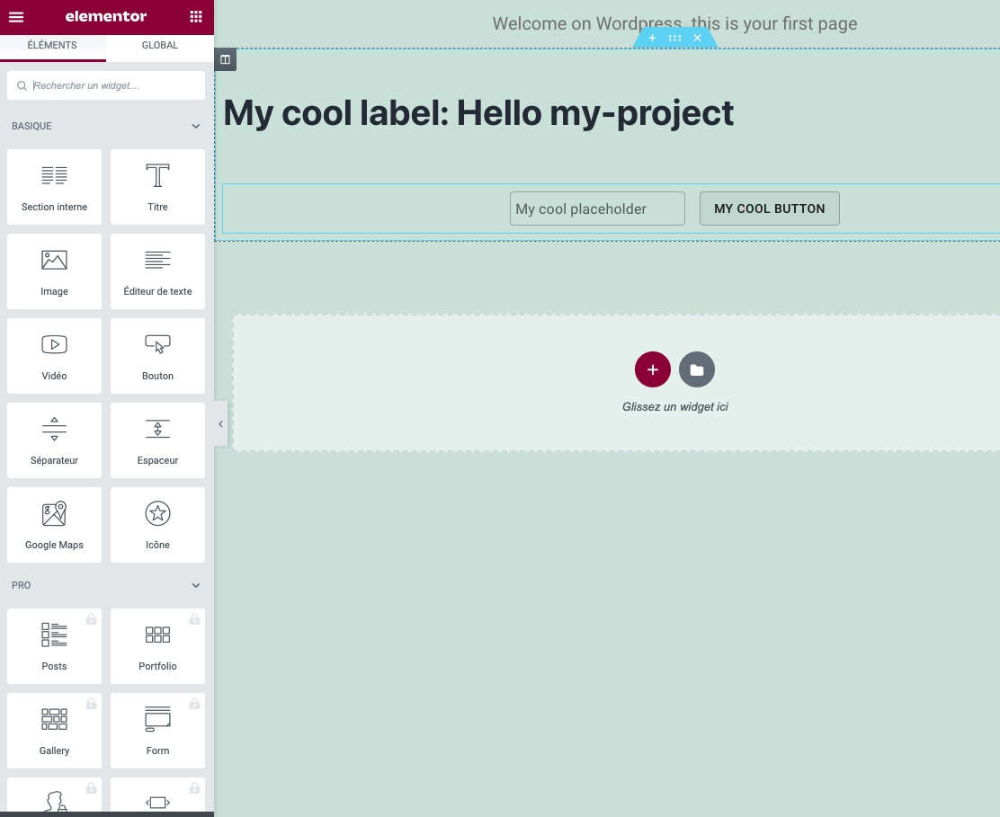
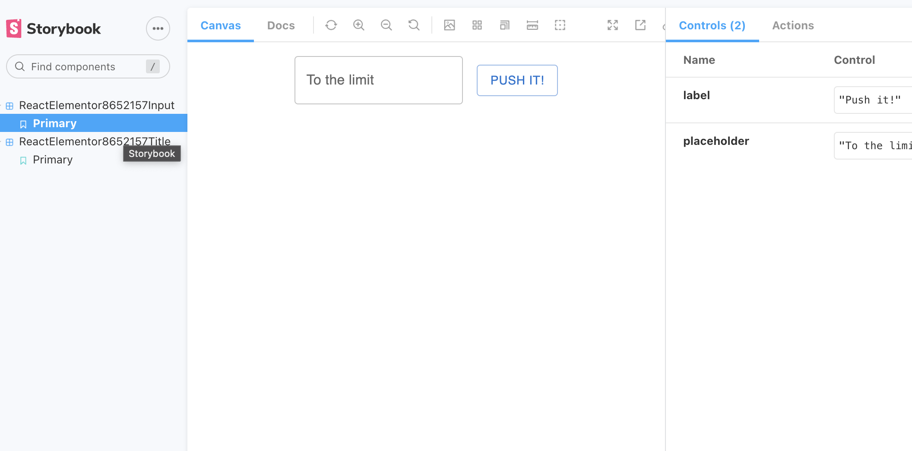

# Nx ReactJS Elementor Widgets

Nx plugin to generate WordPress plugins that enrich Elementor with ReactJS widgets.

All widgets are wrapped in web components that act as a proxy between Elementor and React. All web components use Shadow DOM to prevent CSS conflicts.

State between components is maintained using Redux, but you can use the provider of your choice.



## Requirements

- **Node.js** >= 18 (tested with Node.js 22)
- **Nx** 18.x

## Plugins

| Plugin | Description |
| ------ | ----------- |
| [`@betrue/react-elementor`](https://www.npmjs.com/package/@betrue/react-elementor) | Generate ReactJS Elementor widgets in WordPress plugin |

## Quick Start

### 1. Create a new Nx workspace

```bash
npx create-nx-workspace@18 my-workspace --preset=apps --nxCloud=skip
cd my-workspace
```

### 2. Install the plugin

```bash
npm install -D @betrue/react-elementor
```

### 3. Generate a new Elementor plugin

```bash
npx nx g @betrue/react-elementor:plugin my-project --style=styled-components
```

### 4. Build the WordPress plugin

```bash
npx nx pkg my-project
```

### 5. Deploy

The output is in `dist/elementor/my-project/`. Zip it and upload to WordPress:

```bash
cd dist/elementor/
zip -r my-project.zip my-project/
```

> **Warning for macOS users:** Do not use right-click to zip the folder. Since WordPress 6.4.3, this generates an "Incompatible Archive" error. Use the command line instead.

## Project Structure

After generating a plugin, you will find:

```
my-workspace/
├── my-project/                    # WordPress plugin sources
│   ├── src/
│   │   ├── app/
│   │   │   ├── my-project.ts      # Web component declarations
│   │   │   └── my-project.tsx     # React app entry
│   │   ├── assets/
│   │   └── environments/
│   ├── widgets/                   # Elementor widget PHP files
│   │   ├── my-project-input/
│   │   └── my-project-title/
│   ├── class-react-elementor.php
│   ├── class-widgets.php
│   └── wp-react-elementor.php
│
├── my-project-ui/                 # React components library
│   ├── src/
│   │   └── lib/
│   │       ├── my-project-input/
│   │       │   ├── my-project-input.tsx
│   │       │   ├── my-project-input.view.tsx
│   │       │   └── my-project-input.stories.tsx
│   │       ├── my-project-title/
│   │       ├── common/
│   │       ├── config/
│   │       └── store/
│   └── .storybook/
│
└── dist/
    └── elementor/
        └── my-project/            # Built WordPress plugin (ready to deploy)
```

## Development

### Storybook

Use Storybook to develop and test your React components in isolation:

```bash
npx nx run my-project-ui:storybook
```

Open [http://localhost:4400](http://localhost:4400) in your browser.



### Build with Version

Pass a release version to force resource updates and reset cache in WordPress:

```bash
NX_RELEASE_VERSION=1.0.0 npx nx pkg my-project
```

## Adding New Widgets

### Add a widget to an existing plugin

```bash
npx nx g @betrue/react-elementor:addWidget --name my-widget --plugin my-project --attributes attr1,attr2
```

### Options

| Option | Description |
| ------ | ----------- |
| `name` | **(Required)** Name of the ReactJS Elementor widget |
| `plugin` | **(Required)** Name of the WordPress plugin in which the widget will be generated |
| `attributes` | Comma-separated list of attributes customizable in Elementor |
| `author` | Name of the plugin author |
| `tags` | Add tags to the project (used for linting) |
| `widgetDescription` | Widget description that appears in WordPress plugin view |
| `version` | WordPress plugin version |

### Widget Files

Each widget consists of:

| File | Description |
| ---- | ----------- |
| `my-widget.tsx` | React component (smart component with logic) |
| `my-widget.view.tsx` | React view component (presentational) |
| `my-widget.stories.tsx` | Storybook stories for development |
| `widget.php` | Elementor widget PHP class |

### Registering a Widget

After creating a widget, you must register it in `my-project/src/app/my-project.ts`:

```typescript
import {
  CustomProviders,
  MyWidget,
  WebComponentWrapper,
} from '@my-workspace/my-project-ui';

WebComponentWrapper('my-project-my-widget', MyWidget, CustomProviders);
```

## Working with Attributes

Attributes allow Elementor users to customize your widgets from the WordPress admin panel. They are passed from Elementor (PHP) to your React component via web component attributes.

### Creating a Widget with Attributes

```bash
npx nx g @betrue/react-elementor:addWidget \
  --name user-card \
  --plugin my-project \
  --attributes title,subtitle,imageUrl \
  --widgetDescription "Display a user card"
```

This generates:

1. **React component** (`my-project-ui/src/lib/user-card/user-card.tsx`)
2. **Elementor widget** (`my-project/widgets/user-card/widget.php`)

### How Attributes Flow

```
Elementor Admin → widget.php → Web Component → React Props
```

1. **Elementor Admin**: User configures `title`, `subtitle`, `imageUrl` in the widget settings
2. **widget.php**: Renders `<my-project-user-card title="..." subtitle="..." imageUrl="..."></my-project-user-card>`
3. **Web Component**: Passes attributes to React component as props
4. **React Component**: Receives `{ title, subtitle, imageUrl }` as props

### PHP Widget Structure (widget.php)

The generator creates controls for each attribute:

```php
protected function _register_controls()
{
    $this->start_controls_section(
        'section_content',
        array(
            'label' => __('Content', 'elementor-my-project'),
        )
    );

    // One control per attribute
    $this->add_control(
        'title',
        array(
            'label' => __('Title', 'elementor-my-project'),
            'type' => Controls_Manager::TEXT,
            'default' => __('My title', 'elementor-my-project'),
        )
    );

    $this->add_control(
        'subtitle',
        array(
            'label' => __('Subtitle', 'elementor-my-project'),
            'type' => Controls_Manager::TEXT,
            'default' => __('My subtitle', 'elementor-my-project'),
        )
    );

    $this->add_control(
        'imageUrl',
        array(
            'label' => __('Image URL', 'elementor-my-project'),
            'type' => Controls_Manager::TEXT,
            'default' => __('', 'elementor-my-project'),
        )
    );

    $this->end_controls_section();
}

protected function render()
{
    $settings = $this->get_settings_for_display();
    $this->add_render_attribute(
        'user-card-wrapper',
        [
            'title' => wp_kses($settings['title'], array()),
            'subtitle' => wp_kses($settings['subtitle'], array()),
            'imageUrl' => wp_kses($settings['imageUrl'], array()),
        ]
    );
    ?>
    <my-project-user-card <?php echo $this->get_render_attribute_string('user-card-wrapper'); ?>></my-project-user-card>
    <?php
}
```

### React Component with Props

Define your React component to accept the attributes as props:

```tsx
// my-project-ui/src/lib/user-card/user-card.tsx
import React from 'react';
import PropTypes from 'prop-types';

export interface UserCardProps {
  title?: string;
  subtitle?: string;
  imageUrl?: string;
}

export function UserCard({ title, subtitle, imageUrl }: UserCardProps) {
  return (
    <div className="user-card">
      {imageUrl && }
      <h2>{title}</h2>
      <p>{subtitle}</p>
    </div>
  );
}

// PropTypes are used by WebComponentWrapper to map attributes
UserCard.propTypes = {
  title: PropTypes.string,
  subtitle: PropTypes.string,
  imageUrl: PropTypes.string,
};

export default UserCard;
```

### Advanced Control Types

You can customize the Elementor controls in `widget.php` to use different input types:

```php
// Text input (default)
$this->add_control('title', [
    'label' => __('Title', 'elementor-my-project'),
    'type' => Controls_Manager::TEXT,
    'default' => 'Default title',
]);

// Textarea
$this->add_control('description', [
    'label' => __('Description', 'elementor-my-project'),
    'type' => Controls_Manager::TEXTAREA,
    'default' => '',
]);

// Number
$this->add_control('count', [
    'label' => __('Count', 'elementor-my-project'),
    'type' => Controls_Manager::NUMBER,
    'default' => 10,
    'min' => 1,
    'max' => 100,
]);

// Select dropdown
$this->add_control('size', [
    'label' => __('Size', 'elementor-my-project'),
    'type' => Controls_Manager::SELECT,
    'default' => 'medium',
    'options' => [
        'small' => __('Small', 'elementor-my-project'),
        'medium' => __('Medium', 'elementor-my-project'),
        'large' => __('Large', 'elementor-my-project'),
    ],
]);

// Color picker
$this->add_control('backgroundColor', [
    'label' => __('Background Color', 'elementor-my-project'),
    'type' => Controls_Manager::COLOR,
    'default' => '#ffffff',
]);

// Switcher (boolean)
$this->add_control('showBorder', [
    'label' => __('Show Border', 'elementor-my-project'),
    'type' => Controls_Manager::SWITCHER,
    'label_on' => __('Yes', 'elementor-my-project'),
    'label_off' => __('No', 'elementor-my-project'),
    'return_value' => 'yes',
    'default' => 'no',
]);

// Image picker
$this->add_control('image', [
    'label' => __('Image', 'elementor-my-project'),
    'type' => Controls_Manager::MEDIA,
    'default' => [
        'url' => '',
    ],
]);

// URL input
$this->add_control('link', [
    'label' => __('Link', 'elementor-my-project'),
    'type' => Controls_Manager::URL,
    'placeholder' => __('https://your-link.com', 'elementor-my-project'),
    'default' => [
        'url' => '',
    ],
]);
```

### Widgets Without Attributes

If your widget doesn't need Elementor-configurable attributes (e.g., it fetches data from an API), generate it without the `--attributes` flag:

```bash
npx nx g @betrue/react-elementor:addWidget \
  --name data-dashboard \
  --plugin my-project \
  --widgetDescription "Dashboard with live data"
```

The generated `widget.php` will have an empty controls section, and your React component can manage its own state internally.

### Complete Widget Creation Workflow

1. **Generate the widget**:
   ```bash
   npx nx g @betrue/react-elementor:addWidget \
     --name product-card \
     --plugin my-project \
     --attributes title,price,imageUrl,ctaText
   ```

2. **Create the React component** in `my-project-ui/src/lib/product-card/product-card.tsx`:
   ```tsx
   export function ProductCard({ title, price, imageUrl, ctaText }: ProductCardProps) {
     return (
       <Card>
         <CardMedia image={imageUrl} />
         <CardContent>
           <Typography variant="h5">{title}</Typography>
           <Typography variant="h6">${price}</Typography>
         </CardContent>
         <CardActions>
           <Button>{ctaText || 'Buy Now'}</Button>
         </CardActions>
       </Card>
     );
   }

   ProductCard.propTypes = {
     title: PropTypes.string,
     price: PropTypes.string,
     imageUrl: PropTypes.string,
     ctaText: PropTypes.string,
   };
   ```

3. **Register the web component** in `my-project/src/app/my-project.ts`:
   ```typescript
   import { ProductCard, CustomProviders, WebComponentWrapper } from '@my-workspace/my-project-ui';

   WebComponentWrapper('my-project-product-card', ProductCard, CustomProviders);
   ```

4. **Export from the UI library** in `my-project-ui/src/index.ts`:
   ```typescript
   export * from './lib/product-card/product-card';
   ```

5. **Create Storybook stories** for development:
   ```tsx
   // product-card.stories.tsx
   import type { Meta, StoryObj } from '@storybook/react';
   import { ProductCard } from './product-card';

   const meta: Meta<typeof ProductCard> = {
     component: ProductCard,
     title: 'ProductCard',
   };
   export default meta;

   export const Primary: StoryObj<typeof ProductCard> = {
     args: {
       title: 'Amazing Product',
       price: '99.99',
       imageUrl: 'https://via.placeholder.com/300',
       ctaText: 'Add to Cart',
     },
   };
   ```

6. **Build and package**:
   ```bash
   npx nx pkg my-project
   ```

7. **Deploy** the `dist/elementor/my-project/` folder to WordPress

## CustomProviders

`CustomProviders` is a React component that wraps all your widgets with the necessary providers (Redux store, MUI theme, etc.). It is located in `my-project-ui/src/lib/config/providers.tsx`.

### Default Configuration

By default, `CustomProviders` includes:

- **Redux Provider** - For state management across widgets
- **MUI ThemeProvider** - For Material UI theming
- **Emotion CacheProvider** - For CSS-in-JS styling within Shadow DOM

```typescript
// my-project-ui/src/lib/config/providers.tsx
import { Provider } from 'react-redux';
import { configureStore } from '@reduxjs/toolkit';
import { ThemeProviders } from '../common';

export const muiTheme = responsiveFontSizes(
  createTheme({
    /* your custom theme */
  })
);

const store = configureStore({
  reducer: {
    MyProjectEntity: MyProjectReducer,
  },
  middleware: (getDefaultMiddleware) => getDefaultMiddleware(),
  devTools: process.env.NODE_ENV !== 'production',
});

export function CustomProviders(props: BaseAppProviderProps) {
  return (
    <ThemeProviders theme={muiTheme}>
      <Provider store={store}>{props.children}</Provider>
    </ThemeProviders>
  );
}
```

### Customizing Providers

You can modify `CustomProviders` to add your own providers:

```typescript
// Add React Query, i18n, or any other provider
import { QueryClient, QueryClientProvider } from '@tanstack/react-query';
import { I18nextProvider } from 'react-i18next';

const queryClient = new QueryClient();

export function CustomProviders(props: BaseAppProviderProps) {
  return (
    <ThemeProviders theme={muiTheme}>
      <Provider store={store}>
        <QueryClientProvider client={queryClient}>
          <I18nextProvider i18n={i18n}>
            {props.children}
          </I18nextProvider>
        </QueryClientProvider>
      </Provider>
    </ThemeProviders>
  );
}
```

### Why CustomProviders?

Each widget is rendered inside a Shadow DOM web component. The `WebComponentWrapper` function:

1. Creates a Shadow DOM to isolate styles from WordPress/Elementor
2. Sets up Emotion cache to inject styles into the Shadow DOM
3. Wraps your React component with `CustomProviders`

This ensures that:
- All widgets share the same Redux store (state is synchronized)
- MUI components render correctly inside Shadow DOM
- Your custom theme is applied consistently

## Testing with Docker

If you have Docker installed, you can test the Elementor plugin locally:

### 1. Build the plugin

```bash
npx nx pkg my-project
```

### 2. Start WordPress with Docker

```bash
docker-compose -f my-project/src/docker-compose.yml up -d
```

### 3. Configure WordPress

1. Open [http://localhost:8000](http://localhost:8000)
2. Complete WordPress installation
3. Go to [Plugins](http://localhost:8000/wp-admin/plugins.php) and install/enable Elementor
4. Enable your custom plugin (`my-project`)
5. Create a [new page](http://localhost:8000/wp-admin/post-new.php?post_type=page) and edit with Elementor
6. Search for `my-project-title` and `my-project-input` widgets

### 4. Stop Docker

```bash
docker-compose -f my-project/src/docker-compose.yml down
```

## Available Commands

| Command | Description |
| ------- | ----------- |
| `npx nx g @betrue/react-elementor:plugin <name>` | Generate a new Elementor plugin |
| `npx nx g @betrue/react-elementor:addWidget` | Add a widget to an existing plugin |
| `npx nx pkg <plugin-name>` | Build and package the WordPress plugin |
| `npx nx build <plugin-name>` | Build only (without packaging) |
| `npx nx run <plugin-name>-ui:storybook` | Start Storybook for development |
| `npx nx serve <plugin-name>` | Start development server |

## Troubleshooting

### Build fails with module not found errors

Make sure all dependencies are installed:

```bash
npm install
```

### Storybook port already in use

Kill the process using port 4400 or specify a different port:

```bash
npx nx run my-project-ui:storybook --port=4401
```

### WordPress plugin not loading

1. Check that the plugin is activated in WordPress
2. Verify that Elementor is installed and activated
3. Check the browser console for JavaScript errors
4. Ensure the `dist/main.js` file exists in the plugin folder

## Contributing

Contributions are welcome! Please feel free to submit a Pull Request.

## Maintainer

- [Betrue Agency](https://www.betrue.fr/)
